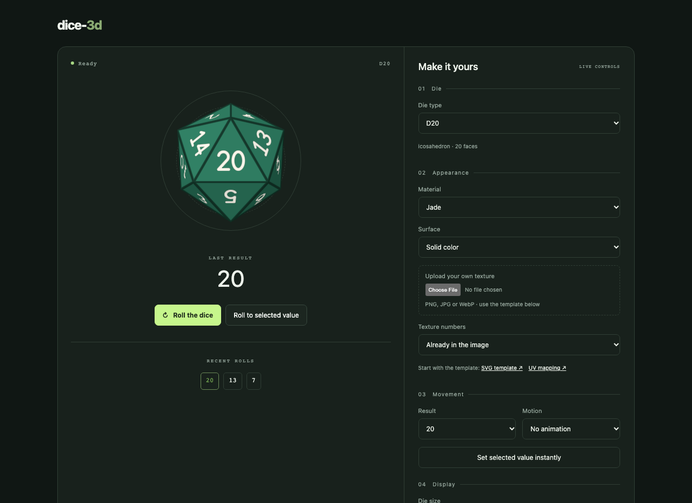
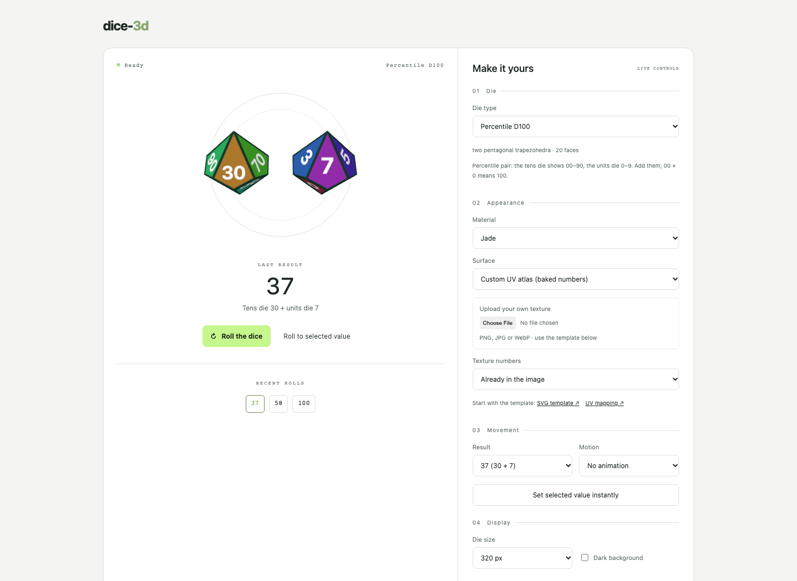

# dice-3d

[**Try the live demo on GitHub Pages →**](https://michalzaawada.github.io/dice-3d/)

Jade D20 with the dark background and the die-type selector:

[](https://michalzaawada.github.io/dice-3d/)

A percentile D100 (tens and units dice) with custom UV artwork and the light background:

[](https://michalzaawada.github.io/dice-3d/)

Independent TypeScript library for 3D dice on the web. This directory is a self-contained
npm-workspaces project with its own dependencies, build, tests and documentation; it has no
dependency on any host application and can be moved to its own repository as-is.

| Package | Path | Purpose |
| --- | --- | --- |
| `dice-3d` | [`packages/core`](packages/core/README.md) | Framework-agnostic WebGL2 dice: D2–D120, percentile, Fate and custom dice. |
| `dice-3d-react` | [`packages/react`](packages/react/README.md) | Optional `<DieView>` and `<D20View>` adapters. |

Examples: [`examples/vanilla`](examples/vanilla) (TypeScript, every core feature) and
[`examples/react`](examples/react).

Documentation:

- [RPG dice support: presets, conventions and limitations](docs/dice-support.md)
- [Architecture and renderer choice](docs/architecture.md)
- [Skins, templates and UV conventions](docs/skins.md)
- [Testing and measurements](docs/testing.md)
- [Release checklist](docs/releasing.md)
- [GitHub Pages and npm pipelines](docs/deployment.md)

## Requirements

Node.js ≥ 22.12 (developed with Node 26, see `.nvmrc`) and npm ≥ 10. Browsers need WebGL2.

## Scripts

Run from this directory after `npm install`:

| Script | What it does |
| --- | --- |
| `npm run build:packages` | Builds `dice-3d` and `dice-3d-react` (ESM + `.d.ts`). |
| `npm run build` | Packages, then the examples. |
| `npm run typecheck` | Type-checks packages, examples, tests and tooling. |
| `npm run lint` | ESLint (the core may not import any package). |
| `npm test` | Unit tests (Vitest: Node, jsdom and SSR projects). |
| `npm run test:e2e` | Browser tests (Playwright: Chromium, Firefox, WebKit) against the built packages. Install browsers once with `npx playwright install chromium firefox webkit`. |
| `npm run size` | Minified/gzip size of the entry points and the 200 kB gzip budget check. |
| `npm run pack:verify` | `npm pack`, installation into a clean temporary project, TypeScript (bundler/NodeNext) and Node SSR import checks. |
| `npm run templates` | Regenerates `packages/core/templates/*.{svg,json}` (D20 net and per-type grid templates) from the source tables. |
| `npm run check` | lint → build packages → typecheck → test → build examples → size → pack:verify. |

To try the examples: `npm run build:packages && npx vite` and open
`http://127.0.0.1:4317/examples/vanilla/index.html` or `/examples/react/index.html`.

## Layout

```text
packages/core/src/
  index.ts        public exports only
  controller/     createD20/createDie, die info, DOM mount, state machine, validation, skins
  geometry/       shapes, die registry and models, D20 numbering table, net and grid templates
  animation/      clock, easing, quaternions, orient/roll tracks, motion modes
  renderer/       WebGL2 renderer, shaders, camera, glyphs and number atlas, mesh
packages/core/templates/   d20-net-v1 and <type>-grid-v1 .svg / .json (published)
packages/core/tests/       unit tests and the numbering fixture
packages/react/            adapter and its tests
examples/                  vanilla and React examples
e2e/                       Playwright tests, test fixture and visual review page
scripts/                   template generation, size and pack verification
```

## Interactive demo

[Open the live playground on GitHub Pages](https://michalzaawada.github.io/dice-3d/)
to roll the die and explore materials, textures and motion controls.

### Run locally

```sh
npm run build:packages
npm run demo
```

Open the address printed by Vite. The playground has a die-type selector with
every preset (D2–D120, D100, tens D10, DF), random rolls, rolls with a chosen
result, recent results, materials, template artwork, custom UV artwork, texture
uploads, number overlays and motion preferences. Switching type disposes the old
die, creates exactly one new canvas, updates the result list and labels, clears
the history and any upload (made for the previous template), regenerates the
built-in skins for the new type and keeps theme, size and motion. A roll that is
still running when the type changes never updates the new die. Percentile dice
explain the 00 + 0 = 100 convention.

For a standalone HTML file that opens directly without a server:

```sh
npm run demo:build
```

Open `examples/vanilla/dist/demo.html`. The file embeds the library, styles and
template downloads; it does not require a network connection. Uploads must use
the selected die's template (D20 net or `<type>-grid-v1`). Random results are
chosen by the demo application, uniformly over the selected type's results.
